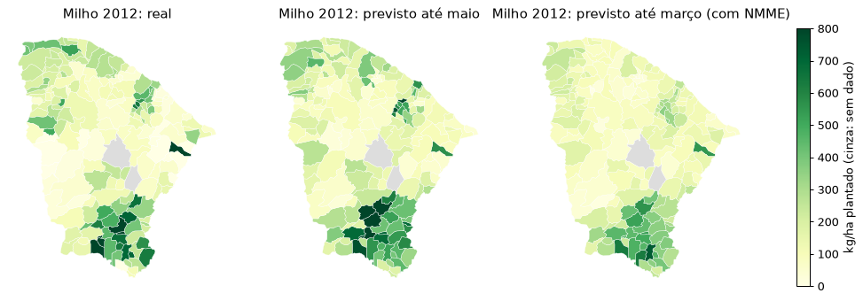

# Previsão de safra de sequeiro no Ceará

Dá para prever em abril, antes da colheita, quanto cada município do Ceará vai colher de milho e feijão? Quase toda
essa lavoura é de sequeiro: depende só da chuva da quadra chuvosa (fevereiro a maio). Quando a safra quebra, o
Garantia-Safra paga o agricultor familiar que perdeu 50% ou mais da produção, então saber cedo onde vai faltar tem uso
para o estado, para cooperativas e para quem planeja o abastecimento.

Este projeto junta a chuva diária dos postos da FUNCEME com a produção municipal do IBGE (1990–2025) e treina modelos
para prever o rendimento de cada município.

## Dados

| Fonte | O que vem | Período |
|---|---|---|
| [IBGE, Produção Agrícola Municipal](https://sidra.ibge.gov.br/tabela/1612) (tabela 1612) | área plantada, área colhida e produção de milho e feijão por município | anual, 1974–2025 |
| [FUNCEME, postos pluviométricos](https://chuvas.funceme.br/) | chuva diária de 844 postos | 1973–hoje; os 184 municípios a partir de 1990 |
| [NOAA PSL, índices climáticos](https://psl.noaa.gov/data/climateindices/list/) | temperatura da superfície do mar (anomalia): El Niño 3.4, Atlântico tropical norte (TNA) e sul (TSA) | mensal, 1948–hoje |

`python scripts/montar_base.py` baixa as três fontes e grava `dados/base.csv`, com uma linha por município, ano e
produto (13.162 linhas). Cada linha traz:

- **Produção:** `area_plantada` (ha), `area_colhida` (ha), `producao` (t) e o alvo `rendimento`, em kg por hectare
  **plantado**. Usar a área plantada, e não a colhida, faz a perda aparecer: quando a safra quebra, parte da área nem é
  colhida. Quando o IBGE marca `-` (zero), a produção entra como 0: são perdas totais, como as 19 linhas da seca de
  2012–2016. Linha marcada `...` (sem dado) sai da base, para não confundir falta de dado com perda.
- **Chuva do município:** média dos postos válidos de cada dia. Mês com mais de 5 dias sem nenhum posto válido vira
  falta, e o ano sem janeiro a maio completo sai da base.
  - `chuva_jan` … `chuva_jun`: total do mês (mm).
  - `chuva_quadra`, `dias_chuva_quadra`, `veranico_quadra`: total, dias com chuva (≥ 1 mm) e maior sequência de dias
    secos de fevereiro a maio.
  - `chuva_fev_mar`, `dias_chuva_fev_mar`, `veranico_fev_mar`: o mesmo só até março, para a previsão antecipada.
- **Oceano** (iguais para todos os municípios no ano, já conhecidos no fim de março): `nino34_djf` (El Niño,
  média de dezembro a fevereiro), `tna_jf` e `tsa_jf` (Atlântico norte e sul, janeiro e fevereiro) e `dipolo_jf`
  (norte menos sul). Pacífico quente (1998, 2016) e Atlântico norte mais quente que o sul (2012) costumam trazer seca
  ao Ceará; é com esses índices que a FUNCEME faz a previsão sazonal.

As secas conhecidas aparecem nos dados. Em 1993, a mediana dos municípios teve 300 mm na quadra e 28 kg/ha de milho;
o mesmo se vê em 1998 e na seca de 2012–2016. O ano mais chuvoso, 2009 (mediana de 1.001 mm), também teve rendimento
baixo, o que indica que a relação com a chuva não é linear.

## Resultados

O notebook [`notebooks/previsao_safra.ipynb`](notebooks/previsao_safra.ipynb) treina um LightGBM e o valida ano a
ano: para cada ano de 2006 a 2025, o modelo aprende só com os anos anteriores e prevê aquele ano, como seria usado de
verdade. O alvo é o rendimento dividido pela média histórica do município (quanto o ano fica acima ou abaixo do normal
dele); prever o rendimento direto ficou pior que a referência.

Erro médio absoluto em kg/ha plantado, 2006–2025:

| Modelo | Feijão | Milho | Geral |
|---|---:|---:|---:|
| Referência: média histórica do município | 121 | 358 | 239 |
| LightGBM com chuva até março | 125 | 357 | 241 |
| LightGBM com chuva até março + oceano e posição do município | 120 | 343 | 231 |
| LightGBM com chuva até maio | 112 | 312 | **212** |

- **Com a chuva até maio, o erro cai 12%** em relação à média histórica. A variável que mais pesa é a chuva da
  quadra relativa ao normal do município.
- **Perda de 50% ou mais** (critério do Garantia-Safra): 19% dos municípios-ano de teste tiveram. O modelo de maio
  aponta 31% deles e acerta 62% das vezes que aponta.
- **Até março, só a chuva não basta:** o modelo empata com a referência. Com os índices do oceano (El Niño e
  Atlântico) e a posição do município, o erro fica 3% abaixo da referência e o acerto ao apontar perda sobe de 51% para
  62%, mas ele aponta menos municípios (13% das perdas). O sinal do oceano tem o sentido esperado, mas é fraco:
  correlação em torno de −0,25 com o rendimento do ano, e só há 35 anos para aprender. Na quadra completa, a chuva de
  abril e maio já carrega essa informação, e o oceano não ajuda.
- Em 2012, primeiro ano da grande seca, havia La Niña (que costuma trazer chuva) e o Atlântico apontava seca. Os dois
  sinais se anularam, e a falta de chuva só ficou clara em abril e maio:



Ressalva: a forma do alvo e as variáveis foram escolhidas olhando os mesmos anos de teste, entre poucas variantes.

Notebook e dados no Kaggle: [notebook](https://www.kaggle.com/code/howluks/previsao-de-safra-de-sequeiro-no-ceara) e
[dataset](https://www.kaggle.com/datasets/howluks/safra-sequeiro-ceara) (privados por enquanto).

## Próximos passos

- Previsão antecipada: o histórico de previsões sazonais da FUNCEME não serve como variável. São boletins em PDF só
  de alguns anos (2012–2014 e 2019–2025), com uma probabilidade única para o estado. A alternativa seria a previsão
  sazonal em grade do Copernicus (C3S) ou do NMME, que tem rodadas retroativas desde os anos 1980–1990.
- Publicar o notebook e o dataset no Kaggle.

## Como rodar

```bash
python scripts/montar_base.py   # Python 3.10+, sem dependências
python tests/test_chuva.py
```

O notebook roda no Kaggle (o dataset já traz `base.csv` e a malha dos municípios) ou localmente, com `pandas`,
`lightgbm`, `scikit-learn` e `matplotlib`, a partir da raiz do repositório. Localmente, a malha vem da API do IBGE:

```bash
curl -L -o dados/brutos/ce_municipios.geojson \
  "https://servicodados.ibge.gov.br/api/v3/malhas/estados/23?formato=application/vnd.geo+json&intrarregiao=municipio&qualidade=minima"
```

Para subir uma versão nova do notebook: `kaggle kernels push -p notebooks`.
